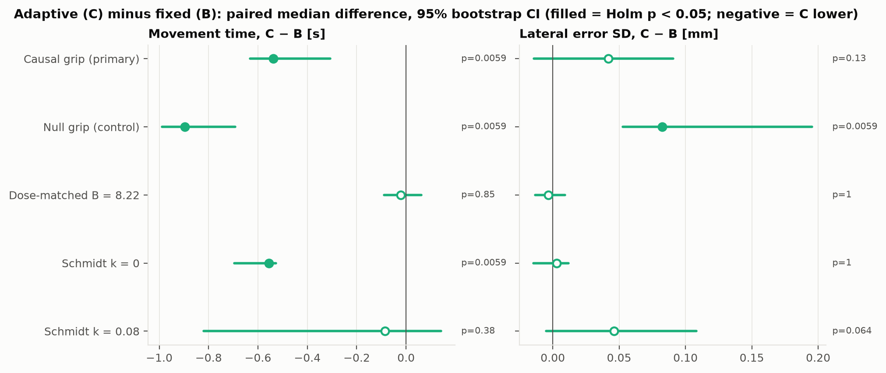
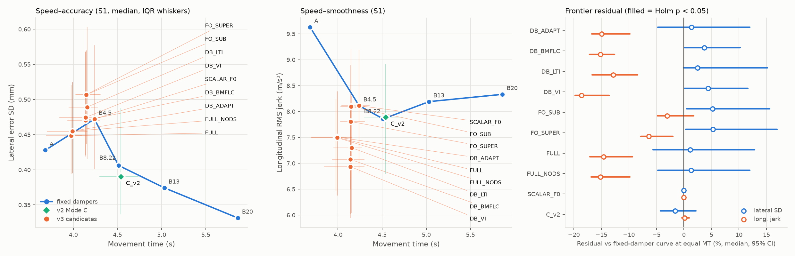

# Poise

Poise is a hand stabiliser: you hold a carriage on a linear rail, and a DC motor makes it feel thicker or thinner, like stirring honey or water, depending on how hard you grip and how much your hand trembles. The firmware runs the Renesas RA4M1 on an Arduino UNO R4 WiFi as a fixed hardware pipeline. A timer event latches the encoder, starts the ADC and paces a 500 Hz control interrupt, and no software polling decides when anything is sampled. A seeded simulation benchmark runs the same control code against a physics model and a model of a human operator, and it shows that the adaptive damping law does **not** beat a fixed damper set to the same average level.

> **Status.** The firmware compiles for the UNO R4 WiFi but has **never run on hardware**: the author does not yet own the board or the rail. Every result below comes from simulation (SIL), which runs the unmodified firmware control code. `telemetry/data_hil/` and `telemetry/data_hw/` are empty on purpose. Nothing in this repository is hardware data.

The name comes from the poise, the CGS unit of dynamic viscosity. Viscous drag is the only thing the device produces, and a steady hand is what it is for. The repository and the code keep the working name SymbioGrip.

A 0.1 Hz LED pacer on the board's matrix (4 s in, 6 s out) gives the user a breathing rhythm. The test task is a wire-loop steering game: guide a stylus through a 2.7 mm sinusoidal corridor without touching the walls.

---

## Key results and figures

Simulation, 10 seeds per condition, paired by seed. A = no assistance, B = fixed damping, C = adaptive damping.

| Condition | Movement time A / B / C [s] | Lateral error SD A / B / C [mm] | Mean damping B / C [N·s/m] |
|---|---|---|---|
| Causal grip model (primary) | 3.61 / 5.04 / 4.55 | 0.439 / 0.361 / 0.412 | 13.0 / 8.22 |
| Null grip model (grip unrelated to task) | 3.65 / 5.04 / 4.19 | 0.498 / 0.354 / 0.461 | 13.0 / 4.84 |
| Dose-matched: B fixed at 8.22 | 3.61 / 4.56 / 4.55 | 0.439 / 0.413 / 0.412 | 8.22 / 8.22 |

Tests are Wilcoxon signed-rank, Holm-corrected within each metric. Full tables are in `telemetry/results/<dataset>/evaluation.md`.

1. **Damping trades speed for smoothness.** Against A, the fixed damper (B) lowers longitudinal jerk (−1.66 m/s³, Holm p = 0.0059) and lateral error SD (−0.090 mm, p = 0.0059). It raises movement time by 1.5 s (p = 0.0059).
2. **C is faster than the pre-registered B (−0.54 s, p = 0.0059), but adaptation is not the reason.** With B fixed at C's mean damping, B and C are indistinguishable on every metric: movement time −0.021 s (p = 0.85), lateral SD −0.003 mm (p = 1), jerk p ≥ 0.62. C's advantage over B = 13 comes entirely from applying less damping on average.
3. **The null-grip control shows the same pattern.** When grip carries no task information, C still beats B = 13 on speed (−0.90 s, p = 0.0059), because C rests at the low end of its range. It is also *worse* on lateral error (+0.083 mm, p = 0.0059).
4. **Wall contacts do not separate the modes** in the primary dataset (0.4 / 0 / 0.4, Friedman p = 0.22). With a noisier operator (Schmidt k = 0.08 s), contacts are 8.3 / 5.4 / 7.0, and no pairwise difference survives Holm correction.



**Conclusion:** the simulation does **not** show that grip/tremor-driven adaptation beats a well-chosen fixed damper. Whether real human grip carries enough task information to change that is the question the [planned human study](#planned-human-study) has to answer. Simulation seeds are not participants: the p-values measure robustness to simulated noise, not effects in a population.

### v3 research lab: can any controller beat every fixed damper?

Nine candidate controllers were tested against the fixed-damper family (B = 0, 4.5, 8.22, 13, 20 N·s/m) and v2 Mode C:

- dual-band tremor/voluntary impedance, using an LMS tremor estimator or a band-pass;
- adaptive dual-band with grip-baseline tracking;
- sub- and super-order fractional dampers;
- tank-gated virtual inertia.

The protocol was pre-registered and hashed before the runs (`docs/InnovationResearch.md`). Full results are in [`InnovationReport.md`](InnovationReport.md).

- **No candidate was promoted.** `firmware/src/` still runs v2 Mode C.
- **Speed–accuracy:** no candidate beats the fixed-damper curve on lateral error. A structural check shows why. Removing *all* x-axis tremor with an oracle changes lateral SD by only 1.8 %: in the model, lateral error comes from y-axis command noise, which the x-axis motor cannot reach.
- **Speed–smoothness:** at equal movement time, dual-band impedance lowers longitudinal jerk below the fixed-damper curve, with all 10 seeds in the same direction.
  - The two variants that pass every check beat the curve by 15.1 % (DB_BMFLC) and 14.9 % (DB_ADAPT).
  - This is significant only under a per-candidate Holm correction chosen after the data were seen.
  - The pre-registered correction could not reach p < 0.05 with 10 seeds. That is a design flaw, and the report states it.
- **Passivity screens out three ideas:**
  - super-order fractional damping, which has excess gain near Nyquist;
  - virtual inertia, with Re{G} ≈ −30 N·s/m at 5 Hz;
  - the band-pass variant, which generates 8.3 mJ under 2.5× back-EMF over-compensation.
- **v2 Mode C weakness:** with a firm 8 N grip or a 6 N resting grip, Mode C is 0.9–1.0 s slower than the dose-matched fixed damper. Its grip pathway reads a high resting grip as difficulty.



---

## Hardware and wiring

### Bill of materials (planned, not yet assembled)

| Part | Role |
|---|---|
| Arduino UNO R4 WiFi (RA4M1, 48 MHz Cortex-M4F) | Controller |
| LPD3806-600BM encoder, 600 PPR, NPN open-collector, on the **idler** pulley | Position: 4× quadrature gives 16.67 µm/count on a 20-tooth GT2 pulley |
| Pololu 37D 4.4:1 brushed gearmotor, 12 V | Damping actuator (drive pulley) |
| TB6612FNG dual H-bridge | Motor driver, 20 kHz PWM |
| Interlink FSR 402 + 10 kΩ resistor | Grip-force sensor (divider into the internal op-amp) |
| GT2 belt, 2 × 20T pulleys, MGN12 rail, 180 mm stroke | Mechanics |
| 1 A polyfuse, 100 µF bulk capacitor, RC parts (below) | Protection |
| 12 V / 2 A supply | Motor power |

### Pinout

Verified against the `renesas_uno` 1.6.0 core's `variant.cpp` and `pinmux.inc`.

```
                         Arduino UNO R4 WiFi
                     +---------------------------+
 Encoder B --4k7 pu--| D2  P104  GTIOC1B (GPT1)  |
 Encoder A --4k7 pu--| D3  P105  GTIOC1A (GPT1)  |       12 V --[1 A polyfuse]--+-- VM  TB6612FNG
  (100R + 1nF each)  |                           |                    100uF ===   |
                     | D4  P106  ----------------|--------------------------- AIN1 |   AO1 --(M)-- AO2
                     | D5  P107  ----------------|--------------------------- AIN2 |
                     | D6  P111  GTIOC3A 20 kHz -|--------------------------- PWMA |
                     | D8  P304  ----------------|--------------------------- STBY |
 Wire loop ---1k-----| D7  P112  GTIOC3B capture|   (100nF to GND)       5V -- VCC |
 (stylus = GND)      |                           |                       GND -- GND (common)
   5V --[FSR 402]--+-| A1  P000  AMP0+           |
                  10k| A2  P001  AMP0-  --+      |   unity-gain follower:
                   | | A3  P002  AMP0O  --+-> ADC|   A2 wired to A3
                  GND+---------------------------+
```

- **Encoder supply and conditioning.** Power the encoder from **5 V only**, never 12 V. Its open-collector outputs use 4.7 kΩ pull-ups to 5 V, a 100 Ω series resistor and 1 nF to ground, plus the GPT digital noise filter (PCLKD/64).
- **Motor arming.** STBY stays LOW until the boot self-test and the motor-polarity test pass.
- **Pull-downs.** Fit 10 kΩ pull-downs on STBY and PWMA so the driver stays off during reset.
- **A0.** Leave it unconnected: the boot self-test loops the DAC back into the ADC on that pin.

---

## RA4M1 silicon architecture

Peripherals time the sampling and actuation; `loop()` does not. The full design, with every register value and its source in the core, is in `docs/HardwareFabric.md`.

```
GPT0 overflow, 500 Hz ──ELC──┬─> GPT1: encoder count latched into GTCCRA
                             └─> ADC14: AN002 scan, 4x hardware average, at the PWM trough
ADC scan end ──NVIC priority 1──> control ISR: HapticEngine::step() (admittance.h, unchanged)
                                   ├─> GPT3 GTCCRC (buffered, applied at the next PWM trough)
                                   └─> AIN1 / AIN2 / STBY through PCNTR3 (atomic set/reset)
```

| Block | What it does |
|---|---|
| **ELC** | GPT0's overflow event (93) is linked to GPT1 capture (ELSR0) and to the ADC start (ELSR8). Encoder and grip are sampled on the same timer edge, with no CPU involvement. |
| **GPT1, 4× quadrature** | Hardware phase counting on P105/P104 (`GTUPSR` 0x6900, `GTDNSR` 0x9600), noise filter PCLKD/64. |
| **GPT3, 20 kHz PWM** | Symmetric triangle mode, `GTPR` = 1200, started in the same `GTSTR` write as GPT0. Because 96,000 = 40 × 2,400, every control tick falls on a PWM trough, which is the middle of the off-time. The grip is therefore sampled while the bridge is not switching. GTIOC3B (P112) captures wire-loop contact edges. |
| **OPAMP0 + ADC14** | The FSR divider is buffered by the internal op-amp as a follower and converted at 14 bits with 4× hardware averaging. |
| **POEG** | If the control ISR overruns into the next tick, POEG latches GTIOC3A LOW until reset. |
| **WDT** | Times out at 10.92 ms and resets the MCU if the ISR stops. Only the control ISR refreshes it. |
| **Boot self-test** | Checks the internal reference against AVCC, a DAC → AN009 loopback, the op-amp follower, every configured register, and the IRQ install. The motor stays disarmed unless all of these pass. |
| **WiFiS3 UDP telemetry** | Telemetry goes to USB by default. Building with `SG_TELEMETRY_SINK=2` (WiFi) or `3` (both) sends 5-row UDP datagrams to port 5005 through the stock ESP32-S3 firmware. Credentials go in a git-ignored `firmware/src/secrets.h`. |

`firmware/esp32_bridge/esp32_bridge.ino` is an optional replacement ESP32-S3 firmware that forwards telemetry as UDP. It has not been compiled. It will not build until its link pins are read from the official schematic, and flashing it removes USB upload to the RA4M1 until the stock firmware is restored.

### Firmware build (verified)

| Build | Exit | Flash | RAM | Warnings in project files |
|---|---|---|---|---|
| `arduino-cli compile -b arduino:renesas_uno:unor4wifi --warnings all firmware/src` (core `renesas_uno` 1.6.0) | 0 | **63,100 B (24 %)** | **7,164 B (21 %)** | 0 |
| Same, with `--build-property "compiler.cpp.extra_flags=-DSG_TELEMETRY_SINK=3"` (USB + WiFi) | 0 | 70,764 B | 9,436 B | 0 |

On Windows, put the core on a short path: GCC 7 fails with paths longer than 260 characters.

---

## Control and passivity verification

### The control law (`firmware/src/admittance.h`)

1. **Velocity:** backward difference of encoder counts, then a 2nd-order Butterworth low-pass at 25 Hz.
2. **Tremor:** acceleration high-passed at 5 Hz. Its RMS (EMA, τ = 0.25 s) is normalised above a 0.25 m/s² floor, which sits 4σ above encoder quantisation noise.
3. **Grip:** inverse FSR divider model F = S·a/(1 − a), smoothed by a 20 ms EMA, normalised over 2.5–8 N.
4. **Damping:** difficulty = weighted grip + tremor, mapped to damping in [4.5, 21.5] N·s/m (Mode C). The damping is slew-limited (240 up / 55 down per second) and passed through a critically damped 36 rad/s smoother.
5. **Drive:** force = −B·v. It is converted to current, then to voltage with back-EMF feed-forward, then to PWM duty. Current is limited to 1.2 A, and a velocity deadband keeps the bridge coasting when the carriage is still.
6. **Passivity:** an exact zero-order-hold (ZOH) energy observer runs alongside a passivity controller. When the observer reports an energy deficit, the controller adds raw-velocity damping and drops the back-EMF feed-forward. See `docs/CONTROL_THEORY.md`.

Modes: **A** = motor coasting, **B** = fixed 13.0 N·s/m (pre-registered midpoint), **C** = adaptive. `setMode()` fully resets all filter and observer state. `admittance.h` is portable C++11 and blind to the corridor geometry. The same file is compiled into the firmware, the SIL bench and the desktop bridge.

### Timing (static worst-case bound, Cortex-M4F at 48 MHz, ×2 for one flash wait state)

| Code | Bound | Source |
|---|---|---|
| v2 `HapticEngine::step()` alone | **33.6 µs** | `arm_cycle_budget.py` |
| v3 worst-case candidate `step()` (R&D only, not in the firmware) | 205.9 µs | `arm_cycle_budget.py` |
| Whole linked control ISR, including `step()`, register I/O, exception entry/exit and lazy FP stacking | **72.9 µs** of the 250 µs budget; no loops, no double-precision calls | `arm_cycle_budget.py --elf` |
| LED matrix refresh (10 kHz, priority 12) | 28.46 % CPU; cannot delay the control ISR | `arm_cycle_budget.py --elf` |
| `millis()` timer (1 kHz, priority 8) | 0.74 % CPU | `arm_cycle_budget.py --elf` |

The ADC conversion time and any interrupt-disabled sections in core code are not bounded statically. The firmware reports them at runtime in its `#STAT` lines (`max_latency_us`, `max_isr_us`).

### Verification (`python telemetry/scripts/verify_control_theory.py` → 19/19 checks pass)

- **Filters:** the coefficients in `admittance.h` match fresh scipy designs to within 4.4e-10. Cut-off frequencies come out at 25.002 Hz and 5.001 Hz.
- **Quantisation:** encoder quantisation gives σ = 0.062 m/s² analytically. Through the real engine the worst case is 0.092 m/s², below the 0.25 m/s² floor.
- **Sampled-data passivity:** generalised Colgate–Schenkel passivity holds over the whole damping range with the passivity controller at full strength. Required damping is 10.0 N·s/m against 15.25 N·s/m available, a margin of 5.25.
- **Closed loop with a compliant hand:** true motor work is −1130 mJ in Mode C and −1484 mJ in Mode B, so the device only absorbs energy.
- **Deliberately unstable test** (back-EMF over-compensated 2.5×): without the passivity controller the motor generates +64 mJ; with it, −11 mJ.

---

## Quick reproduction

```powershell
python -m venv .venv; .venv\Scripts\activate
pip install -r requirements.txt
python telemetry/scripts/run_pipeline.py        # ~40 s; needs MSVC, g++ or clang++
python telemetry/scripts/run_pipeline.py --lab  # adds the v3 lab and its analysis; the cycle bound needs the Arduino renesas_uno core
```

- `native_build.py` finds MSVC through `vswhere`, and falls back to g++ or clang++ on Linux and macOS.
- The SIL datasets regenerate from seed 2026. Files were verified identical on MSVC 19.42; other compilers may differ in the last floating-point digits.

### Desktop human-in-the-loop bench (no hardware needed)

```powershell
python telemetry/scripts/hil_trackpad_bench.py --practice      # 3 unsaved, unblinded familiarisation trials
python telemetry/scripts/hil_trackpad_bench.py --blocks 5      # blind session -> telemetry/data_hil/<session>/
python telemetry/scripts/evaluator.py --data telemetry/data_hil/<session> --min-mt 1.0 --max-speed 0.25
```

A real person steers the simulated stylus with a mouse, trackpad or pen. The firmware engine closes the loop on the same plant model the SIL bench uses. Grip comes from pen pressure, or from holding SPACE if no pen is present. This is **not** hardware-in-the-loop, and its data are labelled `desktop_hitl`.

### Repository layout

```
firmware/src/                     <- runs on the RA4M1
  config.h            all constants (pins, filters, damping range, motor model, timers, telemetry sink)
  ra4m1_registers.h   hardware pipeline: GPT0 500 Hz pacer -> ELC -> GPT1 encoder capture + ADC14 scan;
                      GPT3 20 kHz triangle PWM + contact edge capture; POEG; WDT; analog/register self-test
  admittance.h        HapticEngine (the control law)
  src.ino             control ISR (ADC scan end, NVIC priority 1); loop() does telemetry, commands, LED pacer
  fabric_types.h      ISR snapshot + CSV row formatter
firmware/esp32_bridge/
  esp32_bridge.ino    optional ESP32-S3 UDP forwarder (not compiled: link pins must come from the schematic)
firmware/sim/
  plant.h             4 kHz rail + motor + corridor physics (one implementation, shared)
  operator_model.h    causal human model: delayed vision, preview, Schmidt-law noise, grip from demand
  test_bench.cpp      SIL: 500 Hz HapticEngine::step() against plant + operator; writes CSV + manifest
  hil_bridge.cpp      C ABI over HapticEngine + Plant (libhaptic) for Python
  innovation_engine.h v3 candidate controllers (R&D only, not in the firmware)
  innovation_lab.cpp  v3 suites: Pareto sweep, robustness, passivity/quantisation/adversarial checks
  arm_probe.cpp       step() entry points for the static RA4M1 cycle bound
telemetry/scripts/
  run_pipeline.py     reproduces every software result (build -> verify -> SIL -> stats -> figures)
  verify_control_theory.py   19 computed checks; exits 1 on any failure
  evaluator.py        Friedman + Wilcoxon/Holm, bootstrap CIs, steering-law metrics, auto verdicts
  plot_benchmarks.py  figures from evaluator outputs only
  hil_trackpad_bench.py      desktop human-in-the-loop bench (browser, real human, simulated device)
  serial_logger.py    hardware trial logger (for when the board exists)
  arm_cycle_budget.py static worst-case cycle bounds (step() probes; --elf for the linked ISRs)
  analyze_innovations.py     v3 statistics, frontier residuals, promotion rule -> InnovationReport.md
```

- **What is committed:** the SIL datasets and `telemetry/results/`, so the figures render without a rebuild.
- **What is git-ignored:** build outputs (`firmware/sim/build/`, `*.dll`, `*.exe`) and the v3 lab's raw trials (`telemetry/data_lab/`, about 1,400 CSV files, regenerated by `run_pipeline.py --lab`).
- **Legacy data:** `telemetry/archive/legacy_v1/` keeps the v1 data for transparency. They are **invalid**, and `telemetry/archive/README.md` explains why.

---

## Honest limitations

- **No hardware data.** The register setup was checked against the RA4M1 device header and the Arduino core sources, and it compiles, but it has not run on silicon. Encoder decoding, the ELC event chain, PWM, POEG, the WDT, the op-amp and ADC behaviour on the real board are all unverified. The full list is in section 9 of `docs/HardwareFabric.md`.
- **The human is a model.** `operator_model.h` was tuned only on Mode A (no assistance), before any B/C run. Its structure was still designed by the author: visual delay, preview, Schmidt-law noise, and a grip that rises with path demand. All between-mode results inherit that model's assumptions. See `docs/CALIBRATION.md`.
- **The adaptive law has not beaten a dose-matched fixed damper** in any simulated condition (result 2 above). None of the nine v3 candidates beat the fixed-damper curve on accuracy.
- **Contact counting changed in v4.** Contacts are now counted from hardware-captured falling edges, not 2 ms level samples, so very short touches that v2 would miss are counted. Check this on the rig before comparing hardware contact counts with simulation.
- **The motor parameters are estimates.** K_t,eff = 5.6 N/A at the carriage and R = 2.2 Ω come from datasheets. Passivity needs electrical damping K_t²/R ≥ 9.1 N·s/m, against 14.25 designed. A motor with a weaker constant would need re-verification.
- **The FSR model** uses a nominal scale factor (S = 1 N). A real FSR 402 varies by ±25 % and drifts, so it needs per-user calibration.
- **The desktop bench** couples the pointer to the stylus through a spring–damper. Damping is felt as visual lag, not force, so the bench cannot stand in for the physical device.

## Planned human study

1. **Bring-up.** Run the boot self-test, the polarity test and the `#STAT` timing lines, then check encoder counts per mm against a ruler.
2. **Plant identification.** Measure K_t, R, friction and mass with step tests, update `config.h`, and re-run `verify_control_theory.py`.
3. **Pre-registration, before any data are collected.**
   - Main comparison: B at C's mean damping (dose-matched).
   - Primary outcomes: contacts and lateral SD.
   - Protocol: block-randomised and blinded.
4. **Data collection.** Recruit N ≥ 12 participants with consent (and parental consent for minors). Log with `serial_logger.py` to `telemetry/data_hw/` and evaluate with the same `evaluator.py`.
